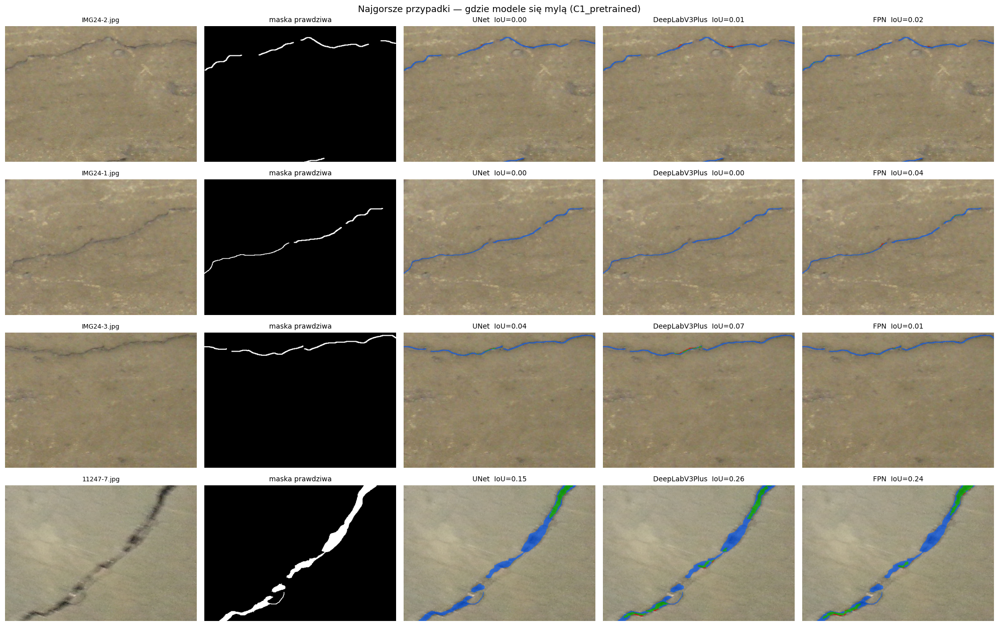

# Segmentacja pęknięć betonu i asfaltu — DeepCrack

Projekt z przedmiotu *Przetwarzanie i analiza cyfrowych danych przestrzennych i budowlanych metodami sztucznej inteligencji* (2026/2027).

Porównanie trzech architektur segmentacji semantycznej (**U-Net**, **DeepLabV3+**, **FPN**) w dwóch konfiguracjach: z enkoderem pretrenowanym na ImageNet i trenowanym od zera — razem 6 treningów.

📊 **Prezentacja:** [`prezentacja.pdf`](prezentacja.pdf)
📓 **Kod:** [`deepcrack_segmentacja.ipynb`](deepcrack_segmentacja.ipynb) (Google Colab, GPU T4)

---

## 1. Problem i zbiór danych

| | |
|---|---|
| **Typ uszkodzenia** | pęknięcia i rysy (szerokość od 1 do 180 px) |
| **Obiekty** | nawierzchnie asfaltowe, ściany i elementy betonowe |
| **Typ problemu** | segmentacja semantyczna binarna: rysa / tło |
| **Zbiór** | DeepCrack — 537 zdjęć 544×384 px z maskami pikselowymi |
| **Podział** | 240 train / 60 val / 237 test (val wylosowany z oficjalnego train, seed 42) |
| **Niezbalansowanie** | ok. 3,5% pikseli to rysa |

**Źródło:** Liu Y., Yao L., Lu X., Xie R., Li L., *DeepCrack: A deep hierarchical feature learning architecture for crack segmentation*, Neurocomputing (2019). Repozytorium: https://github.com/yhlleo/DeepCrack
**Licencja:** według autorów użycie zbioru jest ograniczone do niekomercyjnych badań i celów edukacyjnych. Zbiór **nie jest** kopiowany do tego repozytorium — notatnik pobiera go automatycznie z repozytorium autorów.

## 2. Plan eksperymentu

Wszystkie trzy architektury mają ten sam enkoder **ResNet34** (implementacja: `segmentation_models_pytorch`), więc porównujemy dekodery.

| Parametr | Konfiguracja 1 | Konfiguracja 2 |
|---|---|---|
| **Wagi enkodera (jedyna zmiana)** | **ImageNet** | **od zera** |
| Seed | 42 | 42 |
| Podział danych | 240 / 60 / 237 (`split.csv`) | ten sam |
| Wejście w treningu | losowe wycinki 384×384 | to samo |
| Ewaluacja | pełny obraz 544×384 | ta sama |
| Augmentacja | flipy, obrót 90°, jasność/kontrast | ta sama |
| Epoki / batch | 40 / 8 | 40 / 8 |
| Optymalizator | AdamW, lr 3e-4, weight decay 1e-4, cosine annealing | ten sam |
| Funkcja straty | Dice + BCE | ta sama |
| Wybór checkpointu | najlepsze val IoU | ten sam |

### Hipotezy (zapisane przed treningiem)
- **H1:** pretrening da wyższe IoU dla wszystkich trzech architektur (o 5–15 pp), bo zbiór treningowy jest mały.
- **H2:** największy spadek bez pretreningu będzie u DeepLabV3+.
- **H3:** w konfiguracji 1 U-Net i FPN wypadną lepiej niż DeepLabV3+ (cienkie rysy).
- **H4:** trening od zera zbiega wolniej, a jego błędy to głównie przeoczone rysy (niższy recall).

### Budżet obliczeniowy
Pomiar 1 epoki na 100 obrazach przed treningiem: szacunek **33 min** na cały plan. Rzeczywisty czas 6 treningów: **ok. 25 min** (Google Colab, GPU T4).

## 3. Wyniki (zbiór testowy, 237 obrazów)

Metryki dla klasy „rysa”, liczone globalnie po wszystkich pikselach testu, próg 0,5.

| Model | Konfiguracja | IoU | F1 | Precision | Recall | Val IoU | Trening [min] | Inferencja [ms] |
|---|---|---|---|---|---|---|---|---|
| U-Net | pretrening | 0,723 | 0,840 | 0,913 | 0,777 | 0,805 | 4,7 | 16,6 |
| DeepLabV3+ | pretrening | 0,709 | 0,830 | 0,881 | 0,784 | 0,759 | 3,8 | 15,8 |
| FPN | pretrening | 0,715 | 0,834 | 0,888 | 0,785 | 0,771 | 4,0 | 13,9 |
| U-Net | od zera | **0,726** | **0,841** | 0,902 | 0,789 | 0,756 | 4,6 | 17,3 |
| DeepLabV3+ | od zera | 0,669 | 0,802 | 0,872 | 0,742 | 0,707 | 3,9 | 16,4 |
| FPN | od zera | 0,688 | 0,815 | 0,875 | 0,763 | 0,733 | 3,9 | 14,5 |

**Efekt rezygnacji z pretreningu** (konfiguracja 2 − konfiguracja 1):

| Model | Δ IoU | Δ F1 |
|---|---|---|
| DeepLabV3+ | −3,97 pp | −2,78 pp |
| FPN | −2,69 pp | −1,86 pp |
| U-Net | +0,28 pp | +0,19 pp |


## 4. Wnioski

| Hipoteza | Wynik | Werdykt |
|---|---|---|
| H1 | DeepLabV3+ −4,0 pp, FPN −2,7 pp bez pretreningu; U-Net +0,3 pp | częściowo potwierdzona |
| H2 | największy spadek u DeepLabV3+ | potwierdzona |
| H3 | 0,723 > 0,715 > 0,709 — rozrzut 1,4 pp przy jednym seedzie | kierunek zgodny, różnica w granicach szumu |
| H4 | wolniejsza zbieżność: tak; niższy recall u DeepLabV3+ i FPN, u U-Neta nie | częściowo potwierdzona |

- **Najskuteczniejszy model: U-Net** (IoU 0,72–0,73), jedyny niezależny od pretreningu — prawdopodobnie dzięki połączeniom skrótowym, które przenoszą cechy wysokiej rozdzielczości bezpośrednio do dekodera.
- **Efekt pretreningu zależy od architektury** — nie jest uniwersalny.
- We wszystkich treningach precision > recall: modele częściej przeoczają rysy, niż wykrywają fałszywe.
- **Najgorsze przypadki** to trzy zdjęcia serii IMG24 (gładki tynk, niski kontrast), które występują tylko w zbiorze testowym: z pretreningiem wszystkie modele mają na nich IoU ≤ 0,07; bez pretreningu tylko FPN wykrywa fragmenty rys (IoU do 0,28).



### Ograniczenia
- jeden seed na trening — różnic poniżej 1–2 pp nie da się rozstrzygnąć,
- walidacja (60 obrazów) różni się rozkładem od testu (val IoU 0,71–0,81 vs test 0,67–0,73),
- IoU jest bardzo surowe dla rys o szerokości 2–3 px, próg 0,5 nie był dobierany.

### Co dalej
3–5 seedów na trening (średnia ± odchylenie), F1 z tolerancją 2–3 px, podział danych uwzględniający serie zdjęć, dobór progu na walidacji, test generalizacji na innym zbiorze (np. dacl10k).

## 5. Jak uruchomić

1. Otwórz `deepcrack_segmentacja.ipynb` w Google Colab i ustaw *Środowisko wykonawcze → T4 GPU*.
2. Uruchom komórki po kolei. Notatnik sam instaluje biblioteki i pobiera zbiór DeepCrack.
3. Wyniki (tabele CSV, wykresy, modele) zapisują się na Google Drive w `BudownictwoAI/deepcrack_runs`.

Lokalnie: `pip install -r requirements.txt` (potrzebne GPU z CUDA, ustaw `USE_DRIVE = False`).

## 6. Struktura repozytorium

```
├── README.md
├── requirements.txt
├── deepcrack_segmentacja.ipynb     # cały kod: dane, modele, trening, ewaluacja, wykresy
├── prezentacja.pdf
└── results/
    ├── split.csv                   # podział train/val/test
    ├── timing_estimate.csv         # pomiar czasu przed treningiem
    ├── test_results.csv            # wyniki 6 treningów
    ├── config_effect.csv           # Δ IoU / Δ F1
    ├── test_per_image_iou.csv      # IoU dla każdego obrazu testowego
    ├── *.png                       # wykresy i przykładowe predykcje
    └── <model>__<konfiguracja>/    # history.csv, meta.json dla każdego treningu
```

Wagi modeli (`best.pth`, ok. 90 MB każdy) nie są w repozytorium ze względu na limit rozmiaru GitHuba.
